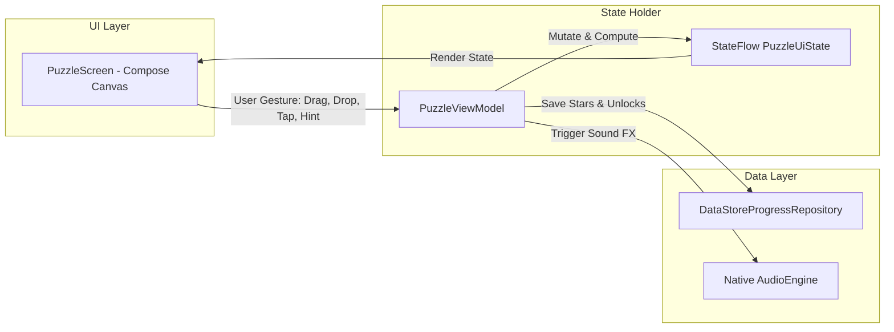

# Kiến Trúc Ứng Dụng Android Native (ANDROID_ARCHITECTURE.md)
## Princess Puzzle for Girls and Toddlers (Modern Android Native Architecture)

---

### 1. Phân Tầng Kiến Trúc (Clean Architecture & Layering)

Toàn bộ ứng dụng được xây dựng theo kiến trúc hiện đại của Android (MVVM + Unidirectional Data Flow) tuân thủ 100% Android Native:

```
app/src/main/java/com/princesspuzzle/storybook/
│
├── core/                       # Hằng số cấu hình & thuật toán giải layout
│   ├── GameConfig.kt           # Dung sai cảm ứng, hằng số vật lý, kích thước nút
│   └── PuzzleLayout.kt         # Tính toán bố cục khung tranh và khay (Portrait/Landscape)
│
├── data/                       # Lưu trữ bền bỉ & tích hợp dịch vụ
│   ├── ProgressRepository.kt   # Quản lý sao, màn mở khóa, cài đặt âm thanh (DataStore)
│   └── PurchaseService.kt      # Hợp đồng mua hàng in-app (Google Play Billing / Simulated)
│
├── puzzle/                     # Động cơ toán học & Logic game
│   ├── JigsawSlicer.kt         # Thuật toán cắt rãnh Bezier 2-12 mảnh
│   ├── PuzzleLevels.kt         # Danh mục metadata 16 màn chơi chính thức
│   ├── PuzzlePhysics.kt        # Động cơ vật lý nảy lò xo, nhấc ngón tay & anti-stuck
│   └── PuzzleViewModel.kt      # ViewModel quản lý StateFlow cho màn chơi ghép hình
│
├── art/                        # Đồ họa vector minh họa & hạt hiệu ứng
│   ├── StorybookPalette.kt     # Bảng màu pastel cổ tích chính thức
│   ├── DrawUtils.kt            # Tiện ích vẽ Path, Gradient, Bo góc, Vương miện
│   ├── StarterScenes.kt        # Vẽ minh họa vector màn 1-4 (Free levels)
│   ├── EnchantedScenesA.kt     # Vẽ minh họa vector màn 5-10
│   ├── EnchantedScenesB.kt     # Vẽ minh họa vector màn 11-16
│   ├── LivingCelebrations.kt   # Hoạt ảnh sống động độc bản cho 16 màn
│   ├── ConfettiParticles.kt    # Hệ thống hạt pháo hoa ngũ sắc zero-allocation
│   ├── MeadowBackdrop.kt       # Khung cảnh nền đồi cỏ cổ tích hoạt họa
│   └── SceneIllustrations.kt   # Bộ đệm LRU cache & tạo thumbnail 200px
│
├── audio/                      # Động cơ âm thanh Android Native
│   ├── AudioEngine.kt          # Hợp đồng phát âm thanh tương tác và nhạc nền
│   └── NativeAudioSynthesizer.kt # Bộ tổng hợp âm thanh procedural AudioTrack / SoundPool
│
└── ui/                         # Giao diện Jetpack Compose
    ├── theme/                  # Định nghĩa Theme, Typography và Shape
    ├── components/             # Nút bấm công thái học, HUD, huy hiệu sao
    │   ├── StorybookControls.kt# Nút 3D, thanh tiến trình, huy hiệu mảnh
    │   ├── ParentalGateOverlay.kt # Cổng phụ huynh giữ 3s & toán nhẩm
    │   └── GrownUpsOverlay.kt  # Bảng điều khiển người lớn & cài đặt
    ├── screens/                # Các màn hình chính
    │   ├── HomeScreen.kt       # Màn hình chính vương miện & vòng quay xem trước
    │   ├── LevelSelectScreen.kt# Lưới chọn 16 màn chơi thích ứng
    │   └── PuzzleScreen.kt     # Màn hình gameplay ghép hình tương tác
    └── AppNavHost.kt           # Quản lý điều hướng Compose Navigation
```

---

### 2. Luồng Dữ Liệu Một Chiều (Unidirectional Data Flow - UDF)



#### 2.1 Trạng thái bất biến (`PuzzleUiState`)
```kotlin
data class PuzzleUiState(
    val level: PuzzleLevel,
    val pieces: List<PuzzlePiece>,
    val placedCount: Int = 0,
    val isCompleted: Boolean = false,
    val activeDraggingPieceId: Int? = null,
    val hintPieceId: Int? = null,
    val isHintActive: Boolean = false,
    val starsEarned: Int = 0
)
```

#### 2.2 Bảo toàn trạng thái khi xoay màn hình (Configuration Changes)
- `PuzzleViewModel` được duy trì xuyên suốt vòng đời cấu hình thông qua `androidx.lifecycle.viewmodel.compose`.
- Khi xoay màn hình giữa Portrait và Landscape:
  - Tọa độ khung tranh và khay chứa được tính toán lại theo `PuzzleLayout`.
  - Tọa độ các mảnh ghép đã snap được gắn chặt vào `slotBounds` mới.
  - Các mảnh ghép đang trong khay được dời nhẹ nhàng vào vị trí khay mới mà không bị biến mất hay văng khỏi màn hình.

---

### 3. Tối Ưu Hóa Hiệu Năng 60 FPS (Hot-Loop Optimizations)

1. **Kiến trúc Canvas 3 lớp (3-Layer Render Pipeline)**:
   - **Lớp 1 (Static Board Cache)**: Tranh nền mờ và các ô ghost slot được vẽ một lần duy nhất vào một `ImageBitmap` offscreen và tái sử dụng.
   - **Lớp 2 (Placed Pieces & Tray Pieces)**: Render các mảnh ghép ở vị trí cố định bằng các sprite bitmap được tạo sẵn (`PieceGeometryCache`).
   - **Lớp 3 (Active Drag Layer)**: Chỉ có mảnh ghép đang được kéo ngón tay là được cập nhật tọa độ liên tục theo thời gian thực.
2. **Khử hoàn toàn rác bộ nhớ (Zero Garbage Collection Allocation)**:
   - Trong vòng lặp `withFrameNanos`, không gọi `new` hay khởi tạo đối tượng mới. Các mảng tính toán tọa độ được tái sử dụng `in-place`.
3. **Bộ đệm hình ảnh giới hạn (Bounded LRU Artwork Cache)**:
   - Chỉ giữ tối đa 2 màn chơi trong bộ nhớ RAM cùng lúc (`ARTWORK_LRU_CAPACITY = 2`), giải phóng bộ nhớ đồ họa ngay khi chuyển màn, đảm bảo hoạt động mượt mà trên các thiết bị Android RAM thấp (2GB-3GB).

---

### 4. Lưu Trữ Dữ Liệu Bền Vững (Jetpack DataStore)

- Sử dụng `androidx.datastore:datastore-preferences` thay thế hoàn toàn SharedPreferences cũ.
- Dữ liệu được ghi bất đồng bộ trên `Dispatchers.IO` với Coroutine an toàn.
- Cấu trúc phiên bản (`schema_version = 1`): Hỗ trợ di chuyển dữ liệu (Migration) dễ dàng trong tương lai nếu nâng cấp cấu trúc lưu trữ.

---

### 5. Cấu Hình Bản Build & Xuất Bản (Build Variants & Release Packaging)

- `debug`: Bật cờ `UNLOCK_ALL_FOR_DEBUG = true` và `ALLOW_BENCHMARK_INTENT = true` hỗ trợ kiểm thử toàn diện mọi màn chơi.
- `releaseTestable`: Dành cho đo đạc hiệu năng thực tế trên thiết bị thật với R8 Shrinking và ký bằng debug key.
- `release`: Tối ưu hóa toàn diện:
  - `isMinifyEnabled = true` (R8 ProGuard tối ưu hóa bytecode).
  - `isShrinkResources = true` (Loại bỏ tài nguyên thừa).
  - Hỗ trợ ký Release Keystore tự động từ biến môi trường.
