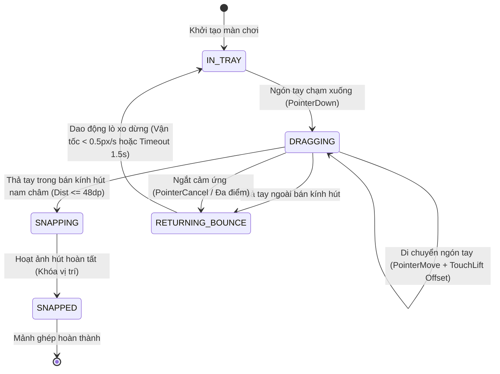

# Cơ Chế Gameplay & Mô Hình Vật Lý (GAMEPLAY_MECHANICS.md)
## Princess Puzzle for Girls and Toddlers (Physics, Slicing & Gameplay State Machine)

---

### 1. Máy Trạng Thái Của Mảnh Ghép (Piece State Machine)

Mỗi mảnh ghép trong màn chơi vận hành theo một máy trạng thái hữu hạn (FSM) chặt chẽ, đảm bảo không bao giờ xảy ra lỗi kẹt hoặc biến mất:

---

### 2. Mô Hình Động Lực Học Vật Lý (Mathematical Physics Model)

#### 2.1 Dao động lò xo giảm chấn (Damped Harmonic Oscillator)
Khi mảnh ghép bị thả rơi bên ngoài vùng hút, nó quay về khay bằng hệ phương trình vi phân dao động tắt dần bậc hai:

$$m \frac{d^2 x}{dt^2} + c \frac{dx}{dt} + k (x - x_{target}) = 0$$

- Khối lượng quy ước: $m = 1.0$
- Hệ số đàn hồi lò xo: $k = 0.18$
- Hệ số cản nhớt (Damping factor): $c = 0.75$ (Đảm bảo dao động tắt dần êm dịu, nảy 2-3 nhịp mà không gây giật lag mắt trẻ)
- Bước tích phân Euler bán ẩn (Semi-implicit Euler integration):
  $$v_{t + \Delta t} = v_t \cdot (1 - c) + \frac{x_{target} - x_t}{m} \cdot k$$
  $$x_{t + \Delta t} = x_t + v_{t + \Delta t}$$

#### 2.2 Cơ chế Touch-Lift Offset
- Khi ngón tay ấn xuống tại tọa độ $(T_x, T_y)$, tọa độ hiển thị của tâm mảnh ghép $(P_x, P_y)$ được tính:
  $$P_x = T_x$$
  $$P_y = T_y - \Delta Y_{lift} \quad (\Delta Y_{lift} = 32\text{dp})$$
- Khi đang kéo, góc xoay tự do của mảnh ghép được nội suy mượt mà về $0^\circ$ (thẳng đứng chuẩn xác theo chiều khung tranh) giúp trẻ dễ dàng ướm vào khung.

#### 2.3 Khử phân bổ bộ nhớ theo chu kỳ khung hình (Zero-Allocation withFrameNanos)
- Toàn bộ các phép tính vật lý, vị trí mảnh ghép, hạt confetti được cập nhật trực tiếp trên các cấu trúc mảng đã cấp phát từ trước (`FloatArray`, `MutableStateFlow`).
- Không tạo mới bất kỳ đối tượng trung gian nào trong vòng lặp khung hình 60 FPS, triệt tiêu hoàn toàn hiện tượng khựng khung hình (jank) do Garbage Collection.

---

### 3. Thuật Toán Cắt Mảnh Ghép Interlocking Bezier (Jigsaw Geometry)

#### 3.1 Hình học rãnh khóa (Tabs & Blanks)
- Mỗi cạnh ghép giữa hai mảnh liền kề được tạo bởi một chốt lồi (Tab) trên một mảnh và một lỗ lõm (Blank) tương ứng trên mảnh đối diện.
- Đường cong nối được tạo bởi 4 đoạn Bezier bậc ba (Cubic Bezier curves):
  1. Đoạn gốc 1: Đi từ góc đỉnh đến chân chốt nối.
  2. Đoạn cổ chốt: Bo cong vào phía trong tạo eo giữ.
  3. Đoạn đầu chốt: Bán nguyệt phình rộng ra ngoài tạo hình nấm chốt khóa.
  4. Đoạn gốc 2: Bo cong đối xứng quay về cạnh đối diện.
- Công thức đường cong Bezier bậc ba:
  $$B(t) = (1-t)^3 P_0 + 3(1-t)^2 t P_1 + 3(1-t) t^2 P_2 + t^3 P_3, \quad t \in [0, 1]$$

#### 3.2 Khử lỗi đường viền hở (Watertight Boundary)
- Cắt và vẽ sử dụng chung một tập hợp điểm điều khiển Bezier được tính toán trước theo tỉ lệ chuẩn $1000 \times 1000$ đơn vị.
- Đảm bảo khi ghép hai mảnh cạnh nhau, khe hở giữa chúng chính xác bằng 0 pixel (watertight), không bị lộ viền nền hay vết cắt răng cưa.

---

### 4. Hệ Thống Gợi Ý Thông Minh (Hint & Shimmer Engine)

1. **Bộ đếm thời gian không hoạt động (Inactivity Watchdog)**:
   - Khi trẻ mở màn chơi mà không chạm vào màn hình trong `5.0 giây`, bộ đếm kích hoạt cờ `isHintActive = true`.
2. **Hiệu ứng trực quan**:
   - Mảnh ghép đầu tiên còn lại trong khay sẽ phát hiệu ứng nhấp nháy ánh kim (Golden Shimmer Pulse).
   - Vị trí ô tương ứng trên khung tranh mờ sẽ sáng bừng đường viền với chu kỳ sin $1.5$ chu kỳ/giây.
3. **Tự động hủy gợi ý**:
   - Ngay khi phát hiện bất kỳ thao tác chạm (`PointerDown`) nào từ trẻ, hệ thống lập tức tắt gợi ý và đặt lại bộ đếm thời gian.

---

### 5. Phát Hiện Hoàn Thành & Đánh Giá Sao (Win Engine)

- **Điều kiện chiến thắng**:
  $$\text{placedCount} == \text{totalCount}$$
- **Trình tự xử lý chiến thắng**:
  1. Khóa toàn bộ tương tác kéo thả.
  2. Kích hoạt hiệu ứng âm thanh kèn trumpet chiến thắng (`playWinFanfare()`).
  3. Khởi chạy hệ thống hạt pháo hoa ngũ sắc (`ConfettiParticles`).
  4. Kích hoạt hoạt ảnh chủ đề tranh sống động (`LivingCelebration`).
  5. Lưu vĩnh viễn tiến trình đạt 3 sao vào Jetpack DataStore với `NonCancellable` scope (đảm bảo không bị hủy nếu người dùng đóng màn hình đột ngột).
  6. Mở khóa màn chơi tiếp theo trong danh sách.
  7. Hiển thị bảng chúc mừng (`CelebrationOverlay`) với nút "Next Level".
